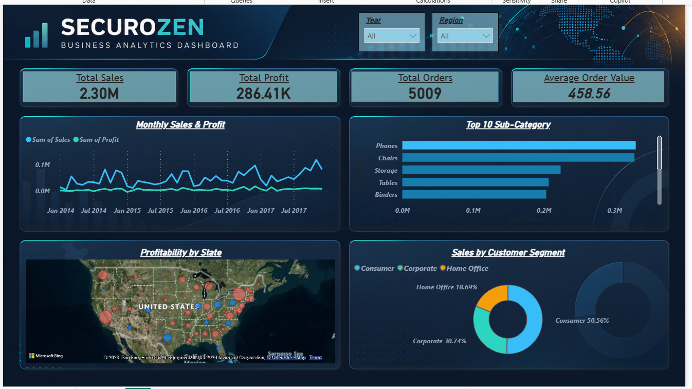
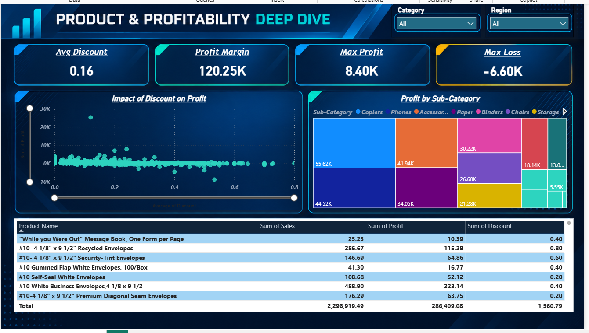
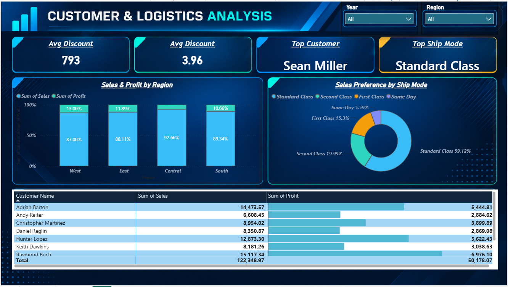

# 📊 Securozen Sales Data Analysis & Business Dashboard
**End-to-End Data Analytics Project | Python • Power BI • DAX**  
**Prepared by:** Sonu Kumar Thakur  
**Role:** Data Analyst Intern @ Securozen  
**Project Domain:** Sales Analytics & Business Intelligence  

## 🚀 Project Overview
This project focuses on transforming raw sales data into meaningful business insights using Python and Microsoft Power BI.
The objective is to evaluate sales performance, profitability, product trends, customer behavior, and shipping preferences through data cleaning, exploratory analysis, custom DAX measures, and interactive dashboards.
The final deliverable is a three-page Power BI dashboard supported by an executive business report containing actionable findings and strategic recommendations.

## 🛠️ Tech Stack
| Technology | Purpose |
|---|---|
| Python | Data cleaning and preprocessing |
| Pandas | Data manipulation and transformation |
| Microsoft Power BI | Interactive dashboard development |
| DAX | KPI calculations and business metrics |
| Microsoft Excel / CSV | Data storage and inspection |
| Microsoft Word / PDF | Executive business reporting |

## 📁 Repository Structure
```text
Securozen-Sales-Analysis/
│
├── data/
│   ├── Sample - Superstore.csv
│   └── Cleaned_Superstore_Sales.csv
│
├── scripts/
│   └── data_cleaning_and_eda.ipynb
│
├── dashboard/
│   ├── Sales_Performance_Dashboard.pbix
│   ├── page1.png
│   ├── page2.png
│   └── page3.png
│
├── report/
│   └── Executive_Business_Report.pdf
│
└── README.md
```
*Note: The filenames above are suggested examples. Update them to match the actual files in your repository.*

## 📈 Dashboard Preview

### Page 1 — Executive Sales Performance
Provides a high-level overview of business performance through KPI cards, monthly sales and profit trends, sub-category comparisons, geographical profitability, and customer segment analysis.



### Page 2 — Product & Profitability Deep Dive
Explores product-level performance and profitability. Discount analysis and conditional formatting help identify loss-making sub-categories and areas requiring further investigation.



### Page 3 — Customer & Logistics Analysis
Examines shipping mode preferences and customer-level performance. An executive matrix with in-cell data bars makes it easier to compare top-performing customers and identify sales concentration.



## 📊 Key Business Metrics
The dashboard focuses on the following core performance indicators:
- **Total Sales:** Overall revenue generated.
- **Total Profit:** Profit earned across sales transactions.
- **Total Orders:** Number of unique orders.
- **Average Order Value (AOV):** Total sales divided by distinct orders.
- **Profit Margin (%):** Profit as a percentage of sales.

These metrics support comparisons across dates, regions, product categories, customer segments, and shipping modes.

## 💡 Key Analytical Highlights
- Developed custom DAX measures for core business KPIs, including Average Order Value and Profit Margin.
- Analyzed monthly sales and profitability trends to understand business performance over time.
- Investigated the relationship between discount levels and profitability.
- Identified a potential profitability issue associated with discounts above 20% in the Furniture category, based on the project analysis.
- Evaluated regional, product-level, customer, and shipping performance to identify opportunities for improvement.
- Designed an interactive, three-page Power BI dashboard for business-oriented reporting.

*Business findings should be interpreted in the context of the dataset and validated against the underlying calculations before being used for operational decisions.*

## 🔄 Project Workflow
```text
Raw Sales Dataset
       ↓
Python & Pandas
       ↓
Data Cleaning and Validation
       ↓
Exploratory Data Analysis
       ↓
Power BI Data Model & DAX
       ↓
Interactive Dashboard
       ↓
Executive Report & Recommendations
```

## 🎯 Business Objectives
The project aims to help business stakeholders:
- Monitor overall sales and profitability.
- Identify products and sub-categories with weak profit performance.
- Understand regional and customer-level sales patterns.
- Evaluate discount-related profitability risks.
- Make more informed decisions using data-driven insights.

## ▶️ How to Explore the Project
1. Clone or download this repository.
2. Review the raw and cleaned datasets in the `data/` directory.
3. Open the Python notebook in `scripts/` to review the cleaning and analysis workflow.
4. Open the `.pbix` file in Microsoft Power BI Desktop to explore the interactive dashboard.
5. Review the executive report in the `report/` directory for the key findings and recommendations.

*Requirements: Python with Pandas and Microsoft Power BI Desktop.*

## 👨‍💻 Author
**Sonu Kumar Thakur**  
Data Analytics | Python | SQL | Power BI  
GitHub: [sonukrthakur3](https://github.com/sonukrthakur3)  

*This project demonstrates an end-to-end data analytics workflow, from raw data preparation to interactive business intelligence and executive reporting.*
